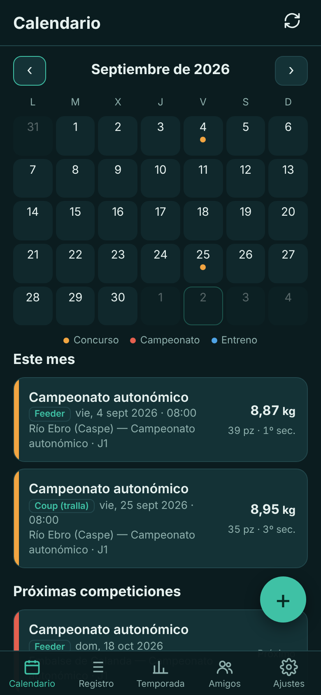
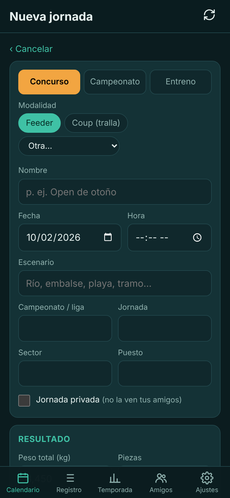
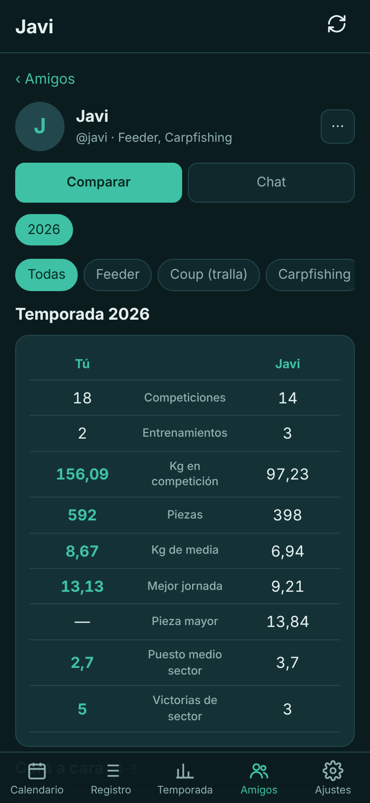
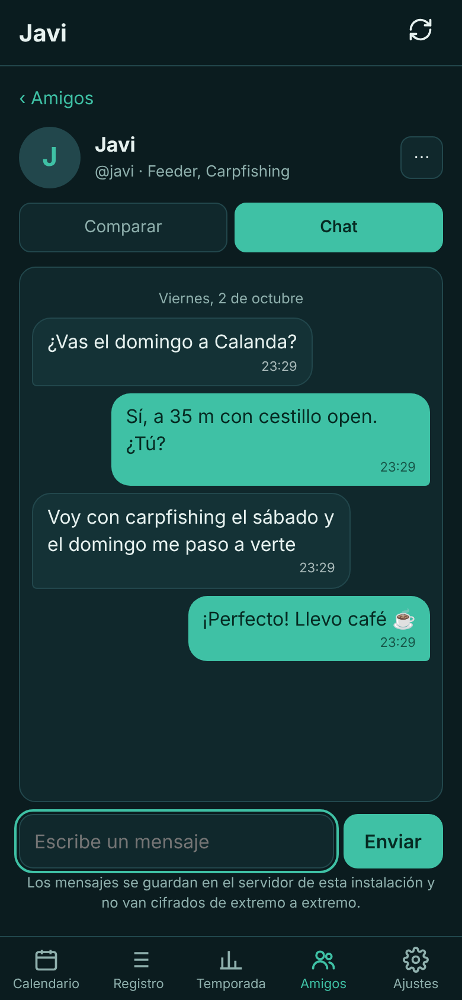
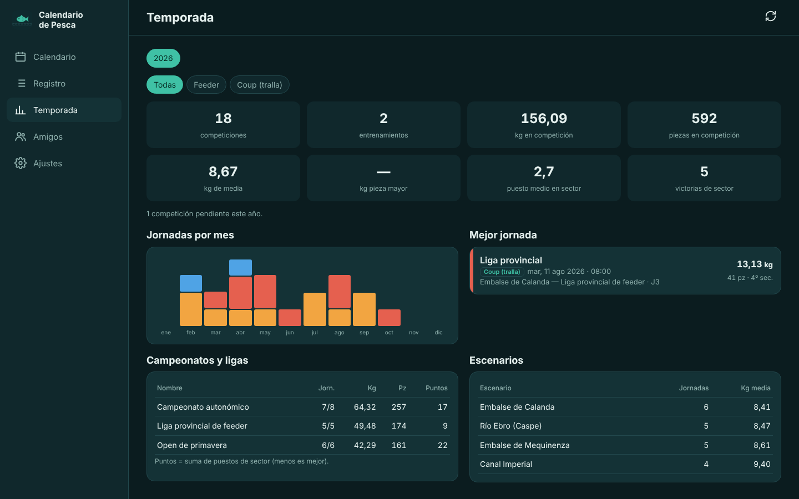

# Calendario de Pesca

Diario de pesca deportiva para el móvil y el ordenador: concursos, campeonatos y entrenamientos de
**cualquier modalidad**, con estadísticas de temporada, amigos, comparativa y chat. Funciona sin conexión,
se instala como app (PWA) y se aloja en tu propio servidor.

<p align="center">
  
  
  
  
</p>

<p align="center"></p>

## Qué hace

- **Calendario** de la temporada con todas tus jornadas; en el ordenador, con el resultado dentro de cada día.
- **Ficha de cada jornada** adaptada a la modalidad: feeder, coup (tralla), carpfishing, black bass,
  spinning, mosca, surfcasting, embarcación y otras. Peso, piezas, pieza mayor, especies, puestos, preparación
  (cebos, engodo, montajes, señuelos…), tiempo, marea en las de mar y una descripción.
- **Temporada**: totales, medias, pieza mayor, puesto medio, victorias de sector, jornadas por mes,
  clasificación por campeonato y por escenario, filtrando por modalidad.
- **Amigos**: comparativa de temporada lado a lado y **cara a cara** en las competiciones del mismo día.
- **Chat** entre amigos, con bloqueo y denuncias.
- **Privacidad** por defecto: tus amigos solo ven resultados salvo que elijas compartir todo, puedes marcar
  jornadas como privadas, descargar todos tus datos y eliminar la cuenta desde la app.
- **Sin conexión**: todo se guarda en el dispositivo y se sincroniza al volver a tener red.
- **Sin dependencias**: JavaScript sin frameworks, backend en Python con solo la librería estándar y SQLite.

## Probarlo en un minuto

```bash
git clone https://github.com/enriquezaporta/calendario-pesca.git
cd calendario-pesca
python3 tools/dev.py
```

Abre <http://localhost:8080> y crea una cuenta. Solo necesitas Python 3.10 o superior.

## Instalarlo

- **Docker**: `docker compose up -d` con el [`docker-compose.yml`](docker-compose.yml). Guía en [docs/docker.md](docs/docker.md).
- **Servidor Debian/Ubuntu o LXC de Proxmox**: `bash deploy/install.sh`. Guía en [docs/instalacion.md](docs/instalacion.md).

En los dos casos hace falta un proxy con **HTTPS** delante: la app lo necesita para instalarse en el móvil y
funcionar sin conexión.

## Documentación

| | |
|---|---|
| [Uso](docs/uso.md) | Cada pantalla, con capturas de móvil y escritorio. |
| [Instalación](docs/instalacion.md) | Servidor o LXC, HTTPS, actualizaciones, copias y administración. |
| [Docker](docs/docker.md) | Imagen, compose, proxy y copias. |
| [Arquitectura](docs/arquitectura.md) | Datos, sincronización, API y decisiones de diseño. |
| [Seguridad](docs/seguridad.md) | Medidas aplicadas y cómo revisarlas. |
| [Privacidad y RGPD](docs/privacidad.md) | Qué hace la app y qué tiene que hacer quien la publique. |

## Pruebas

```bash
python3 -m unittest discover -s tests -v
```

Las pruebas del backend cubren cuentas, aislamiento entre usuarios, amigos, niveles de compartir, chat,
bloqueos, denuncias, exportación, borrado de cuenta, límites de intentos y migraciones. Se ejecutan en cada
`push` con GitHub Actions.

## Autor

**Enrique Zaporta Sierra** · [github.com/enriquezaporta](https://github.com/enriquezaporta)

Licencia [MIT](LICENSE).
