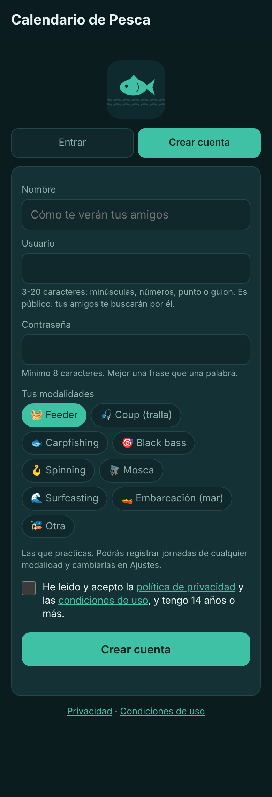
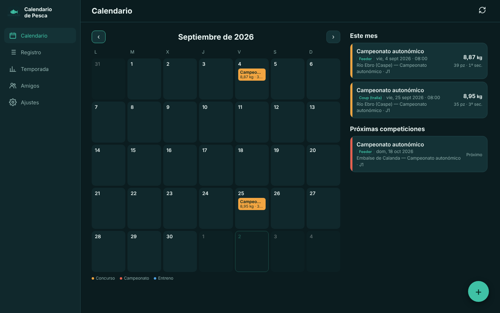
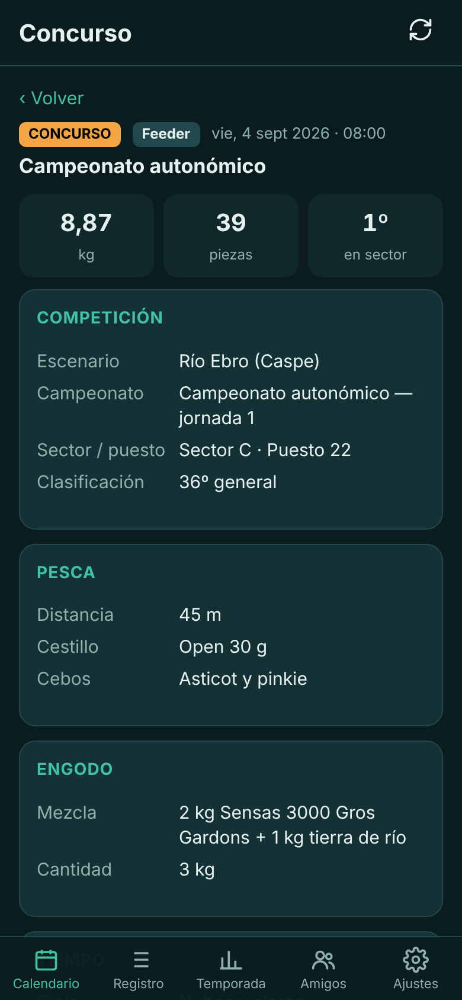
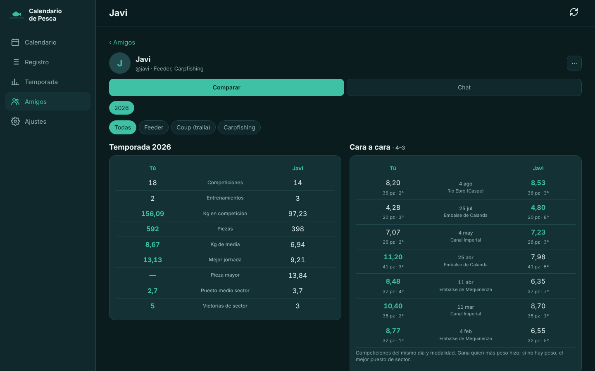
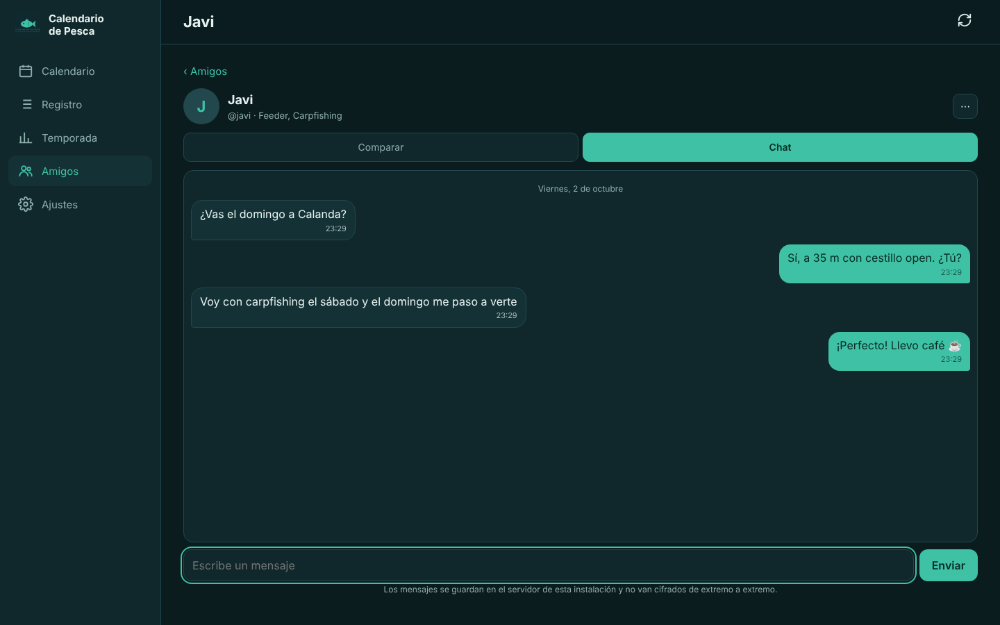
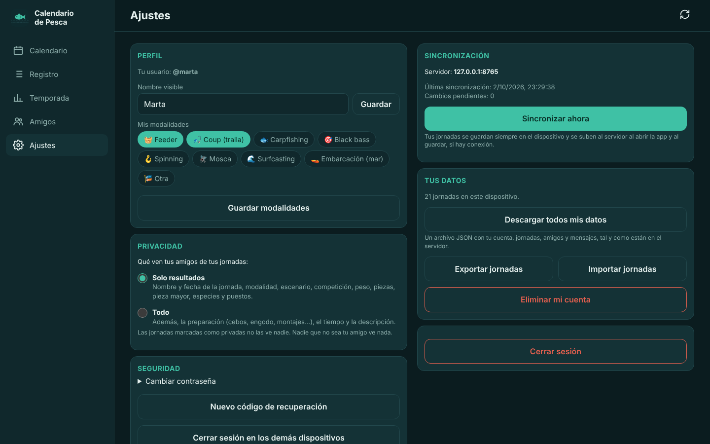

# Uso

## Crear cuenta

Elige tu nombre visible, un usuario (es público: tus amigos te buscarán por él), una contraseña de al menos
8 caracteres y **tus modalidades**. Al terminar verás tu **código de recuperación**: guárdalo, porque la app no
pide correo y es la única forma de recuperar la cuenta si olvidas la contraseña.

## Calendario

Los días con jornadas llevan un punto de color: naranja para concurso, rojo para campeonato y azul para
entrenamiento. Toca un día para ver sus jornadas y pulsa **+** para añadir una ese día. Debajo aparecen las
próximas competiciones.

En el ordenador cada día muestra el nombre, los kilos y las piezas, y la lista del mes queda a la derecha.

## Jornadas

El formulario cambia según la **modalidad**: aparecen tus modalidades arriba y, en «Otra…», el resto.
Cada una tiene sus campos (cestillo y engodo en feeder, longitud de caña y flotador en coup, montaje, horas y
picadas en carpfishing, señuelos y técnica en black bass o spinning, moscas en mosca, plomo y marea en
surfcasting…). Si cambias de modalidad a mitad, no se pierde lo que ya has escrito.

- **Jornada privada**: no la ve nadie más.
- **Duplicar**: crea una jornada nueva con la misma modalidad, escenario y preparación.

 

## Temporada

Totales del año, kilos de media, pieza mayor, puesto medio y victorias de sector, jornadas por mes,
clasificación por campeonato (puntos = suma de puestos de sector) y por escenario. Si practicas varias
modalidades puedes filtrar por cada una.

## Amigos, comparativa y chat

Envía una solicitud con el usuario de tu amigo. Cuando la acepte:

- **Comparar**: vuestra temporada lado a lado y el **cara a cara** en las competiciones del mismo día y
  modalidad. Gana quien más peso hizo; si no hay peso, el mejor puesto de sector.
- **Chat**: mensajes entre amigos. En el ordenador, Intro envía y Mayús+Intro hace salto de línea.
- **⋯**: quitar de amigos, denunciar o bloquear. Un usuario bloqueado no puede enviarte solicitudes ni mensajes.

## Ajustes

- **Perfil**: nombre visible y modalidades.
- **Privacidad**: qué ven tus amigos. *Solo resultados* (por defecto) o *Todo*, que añade la preparación,
  el tiempo y la descripción.
- **Seguridad**: cambiar la contraseña, crear un código de recuperación nuevo y cerrar la sesión en los demás dispositivos.
- **Tus datos**: descargar todo lo que hay en el servidor, exportar o importar tus jornadas y eliminar la cuenta.
- **Cerrar sesión**, con la opción de borrar también tus jornadas de ese dispositivo.

## Sin conexión

Todo lo que registras se guarda primero en el dispositivo. El botón de flechas de arriba sincroniza, y el
número que lleva son los cambios pendientes de subir. La app sincroniza sola al abrirse y al guardar si hay
conexión. Los amigos y el chat necesitan conexión con el servidor.
